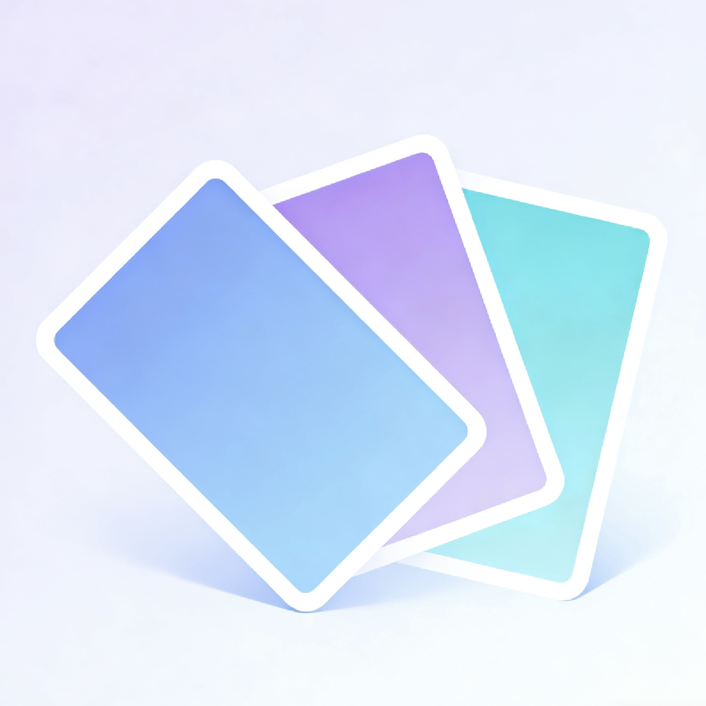
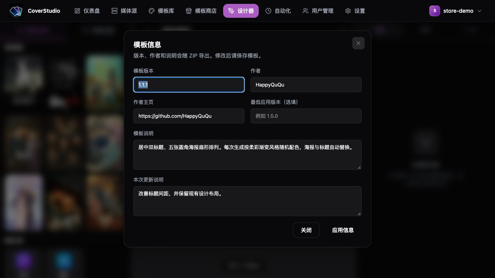

# LibraryCoverStudio

<p align="center">
  <a href="README.md">简体中文</a> · <strong>English</strong> · <a href="CHANGELOG.md">Changelog</a>
</p>

<p align="center">
  <picture>
    <source media="(prefers-color-scheme: dark)" srcset="web/public/logo-d.png">
    
  </picture>
</p>

<p align="center">
  <strong>🎨 Design Jellyfin / Emby library covers and refresh them on a schedule.</strong>
</p>

<p align="center">
  Choose a template, make it yours, and preview a consistent look for movies, series, and anime.
</p>

<p align="center">
  <a href="https://github.com/HappyQuQu/library-cover-studio/actions/workflows/ci.yml"></a>
  <a href="https://hub.docker.com/r/evanqu/library-cover-studio"></a>
  
  
</p>

<p align="center">
  <a href="#quick-start">Quick start</a> · <a href="#screenshots">Screenshots</a> · <a href="#automation">Automation</a> · <a href="https://github.com/HappyQuQu/library-cover-store">Community templates</a> · <a href="#documentation">Documentation</a>
</p>

LibraryCoverStudio is a self-hosted tool for designing and automating media library covers.
It reads poster artwork through the Jellyfin / Emby API, then generates and uploads a **cover for each selected library**:
select three libraries to generate three covers. No media directory mount is required, and the core features work without an AI service.


## ✨ Features

| Feature | What you can do |
| --- | --- |
| Visual designer | Drag posters, text, and shapes; adjust layers, rounded corners, rotation, strokes, and backgrounds with live previews. |
| Seven built-in templates | Start with 1920 × 1080 designs; duplicate and edit, import or export ZIP packages, and restore saved revisions. |
| Community template store | Search and download designs, check authors, versions, and total downloads, and add templates to your library. |
| Jellyfin / Emby | Connect media servers and set a template, titles, and artwork order for each library or collection. |
| Automated updates | Generate and upload covers manually or on daily, weekly, monthly, or custom Cron schedules. |
| Real previews and history | Preview using actual library posters before uploading, then inspect per-library results and download the generated images. |
| Optional AI assistant | Connect your own AI service to create editable designs from text or reference images. |
| Fonts and data management | Use custom fonts, PNG / JPEG / WebP output, history retention, configuration export, and cache cleanup. |
| Chinese and English UI | Chinese by default, with English available throughout the app. Switching preserves drafts, canvas state, task settings and AI conversations. |
| Update notifications | Read official release notes in Settings and see a notification when a newer version is available. |

## 🌐 Interface Language

Simplified Chinese and English are supported. **A first visit always uses Chinese.** Switch on the sign-in page, in the account menu, or under Settings → Appearance → Language. The task wizard, template details and AI workspace also provide a language switch. Your choice stays in this browser, synchronizes across tabs of the same origin, and survives reloads and sign-out.

Switching changes interface text and display formatting. It retains unsaved forms, canvas objects and undo history, wizard settings and reference images, without repeating preview or AI generation requests. Cron expressions, scheduler time zones and execution timestamps remain unchanged.

Template and library names, canvas text, user input, community descriptions, release notes, diagnostics and AI instructions/conversations/output stay in their original language. Use your prompt to choose the language of generated content. Missing translations fall back to Chinese; the browser's language does not change the first-visit default.


> This English UI example uses an isolated fixture with sample accounts, libraries, bundled artwork and simulated preview responses. Other screenshots below show the Chinese interface.

<a id="quick-start"></a>

## 🚀 Quick Start

You need Docker and Docker Compose v2. The image supports Linux `amd64` / `arm64`.
**One image, one container, one port** for the web interface, API, cover rendering, and scheduled tasks.

Create an empty directory and save the following as `compose.yaml`, or use the [example configuration](doc/compose.yaml):

```yaml
services:
  library-cover-studio:
    image: evanqu/library-cover-studio:latest
    restart: unless-stopped
    environment:
      JWT_SECRET: "REPLACE_WITH_RANDOM_JWT_SECRET"
      ENCRYPTION_KEY: "REPLACE_WITH_RANDOM_ENCRYPTION_KEY"
    ports:
      - "8080:8080"
    volumes:
      - ./data:/app/data
```

Run `openssl rand -hex 32` twice and use a different result for each secret, then start the container:

```bash
docker compose up -d
```

Open `http://<your-server-LAN-address>:8080` (or [http://localhost:8080](http://localhost:8080) on the same machine)
and register an account. **The first account becomes the administrator.**

### Configuration

| Setting | What to change |
| --- | --- |
| `image` | Use `latest` by default, or pin a version tag already published on Docker Hub. |
| `JWT_SECRET` | Signs login tokens. Set a random value on first deployment and keep it during upgrades. |
| `ENCRYPTION_KEY` | Encrypts media-server and AI credentials. Set a different random value and keep it during upgrades. |
| `ports` | Change the left-hand port, for example `"9000:8080"`, then access port `9000` on the host. |
| `./data:/app/data` | Stores the database, templates, fonts, settings, and execution history. You can replace the left-hand path with an absolute NAS directory. |

Before upgrading, back up `compose.yaml` and the entire `data` directory. Preserve the original secrets and `data/.encryption-salt`.
See the [Docker deployment guide](doc/Docker_Deployment.md) for NAS access, reverse proxies, backup, recovery, and migration from older deployments.

<a id="screenshots"></a>

## 🖼️ Screenshots

### Template library: choose a style and make it yours

The seven built-in styles are a pastel fan, vertical poster wall, tilted rounded poster wall, diagonal hero image,
soft centered title, stacked rounded cards, and a banner background with a poster row.
Default templates are locked and ready for tasks; duplicate one to edit it. Each template keeps up to 50 saved revisions.
Administrators can also restore the default templates under Settings → Data management while keeping custom templates and copies.


### Community store: discover and add designs

Search by template, author, or description, sort by download count, and browse with pagination.
Downloads appear in the template library, designer, and automation menus; the same version is not added twice.
When updating a template with the same name, you can make a backup copy first. Updates preserve its ID, task references, and history.


### Automation: preview real artwork and review results

Use different templates and titles for each library. Generate real previews before saving, then inspect upload results and download cover images after execution.


<details>
<summary>More screenshots: media sources, backgrounds, template metadata, and schedules</summary>

### Media sources


### Artwork backgrounds

Use the first poster or the first item's landscape backdrop, with adjustable blur and dimming.
If the landscape backdrop is missing, rendering falls back to the first poster.


### Template metadata

Version, author URL, description, changelog, and minimum application version are preserved through ZIP import/export, duplication, and revision restoration.



### Restore default templates


### Task configuration and schedules


</details>

> Screenshots use an isolated demo environment with example accounts, libraries, and bundled posters. Store download counts and template versions are demonstration data.

<a id="automation"></a>

## ⚡ From Connection to Scheduled Updates

1. **Connect a server**: Open Media Sources → Add server, enter the type, address, and API key, then test the connection and inspect the libraries. The address must be reachable from the backend container; use a LAN IP or reachable domain for a NAS or local server.
2. **Configure covers**: Open Automation → New task, select libraries or collections, apply a template in bulk, then adjust titles and artwork order for each target. Collection covers use artwork from their members and upload to the collection itself. Each selected library or collection gets one cover. Generate a real preview to check the result; previews do not upload or modify anything on the media server.
3. **Set a schedule**: Choose manual execution or a daily, weekly, monthly, or Cron schedule. Check the scheduler timezone and next three runs before enabling the schedule.
4. **Save and run**: Saving does not upload immediately. Use Run Now to verify the task, then open Run history to inspect per-library results and download covers.

| Schedule | Cron expression |
| --- | --- |
| Daily at 04:00 | `0 4 * * *` |
| Mondays at 04:00 | `0 4 * * 1` |
| First day of each month at 04:00 | `0 4 1 * *` |
| Every hour | `0 * * * *` |

The default scheduler timezone is `Asia/Shanghai`; check the timezone shown on the task page.
The backend must keep running. Enabled schedules reload after a restart, but missed runs are not replayed.
By default, each task retains up to 50 finished executions from the last 30 days; administrators can adjust these limits.

**Execution replaces the selected libraries' or collections' covers.** Back up original covers beforehand if you need them;
execution history stores images generated by this application.
See the [automation guide](doc/Automation_Guide.md) for illustrated steps, pausing schedules, and troubleshooting.

## 🎨 Customize and Share Templates

Use `{{primary_title}}`, `{{secondary_title}}`, and `post1`–`post9` poster placeholders in the designer
to reuse a layout across libraries. Choose a fixed background or enable random backgrounds for task generation.
Save template changes before running a task.

Export a ZIP from the template library to back up, migrate, or share a design.
Exports include the custom fonts actually used; imports and store downloads install them automatically.
Fonts with the same name but different contents are saved separately and references are adjusted, preserving existing fonts.
System fonts are not bundled automatically.

To share through [library-cover-store](https://github.com/HappyQuQu/library-cover-store),
extract the ZIP, place `template.json`, `preview.jpg`, and any bundled `fonts/` in a dedicated template directory,
and submit a pull request. See the [submission guide](https://github.com/HappyQuQu/library-cover-store#提交模板) for package format, size limits, and publishing steps.

The store and release checks require backend access to GitHub; no GitHub token is needed.
If connections fail, use Settings → Network to test access and choose direct connections, environment proxy settings, or a custom proxy.
See [GitHub network settings](doc/Docker_Deployment.md#github-网络设置).

## 🤖 Optional AI Design Assistant

Connect your own service under Settings → AI configuration, enter its address and key, fetch the model list, and choose a default model.
OpenAI-compatible APIs, Claude, and Ollama are supported. Models with image input can use up to three JPG / PNG / WebP reference images;
when image capability is unknown, manual confirmation is required.
Preview generated designs before applying them to the canvas for further editing.

<a id="development"></a>

## 🧑‍💻 Local Development

Requirements: Node.js 22 and pnpm 10.28.0. The frontend defaults to port `5173`, and the backend to `3000`.

```bash
corepack enable
pnpm install --frozen-lockfile
cp .env.example .env
# Edit .env and set JWT_SECRET and ENCRYPTION_KEY to different random secrets
pnpm db:migrate
pnpm dev
```

```bash
pnpm check:i18n  # Frontend text, resources, interpolation and plural checks
pnpm test   # Regression tests with an isolated database and local mock media API
pnpm build  # Build the frontend and backend
```

The frontend uses React 19, Vite, Tailwind CSS, Fabric.js, Zustand, and TanStack Query.
The backend uses Node.js, Express, and SQLite / Drizzle, with `@napi-rs/canvas` and Sharp for cover rendering.

<a id="documentation"></a>

## 📖 Documentation

The deployment guides, QA checklist and changelog are in Chinese. The contribution rules are available in both languages.

- [Contributing](CONTRIBUTING.en.md) · [Bilingual QA checklist](doc/I18n_QA.md): translation conventions, source-content boundaries and disposable browser fixtures.

- [Docker deployment](doc/Docker_Deployment.md): NAS access, reverse proxies, upgrades, backup, and recovery.
- [Automation guide](doc/Automation_Guide.md): task configuration, variables, schedules, and execution history.
- [Publishing workflow](doc/Publishing.md): GitHub Actions, Docker Hub images, and version releases.
- [Docker Hub overview](README.dockerhub.md): deployment and usage instructions for the image page.
- [Technical architecture](doc/Technical_Architecture.md): source structure, cover generation and template ownership.
- [Template store repository](https://github.com/HappyQuQu/library-cover-store): community template sources, previews, contributions and publishing.
- [Changelog](CHANGELOG.md) · [Report an issue](https://github.com/HappyQuQu/library-cover-studio/issues).

## 📄 License

MIT License.
