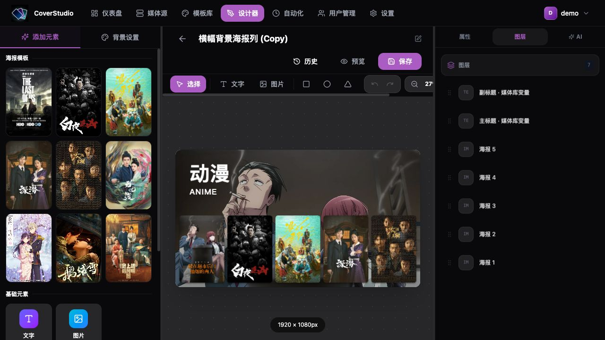
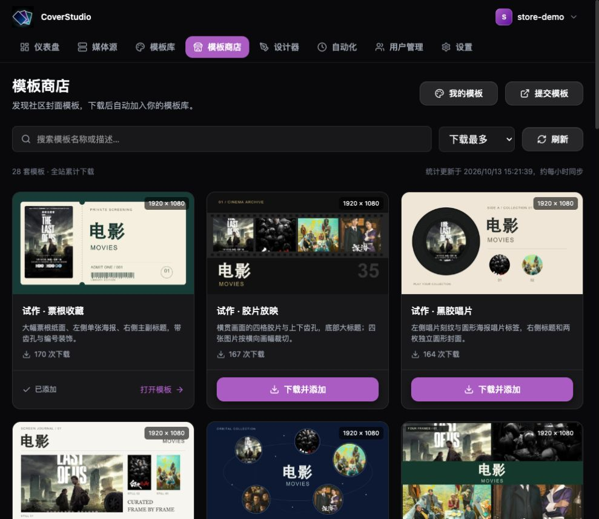
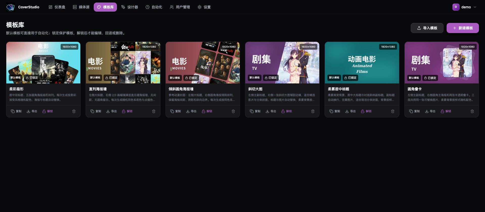
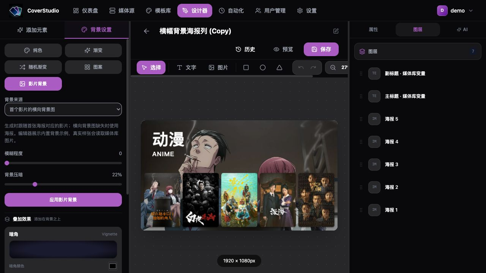
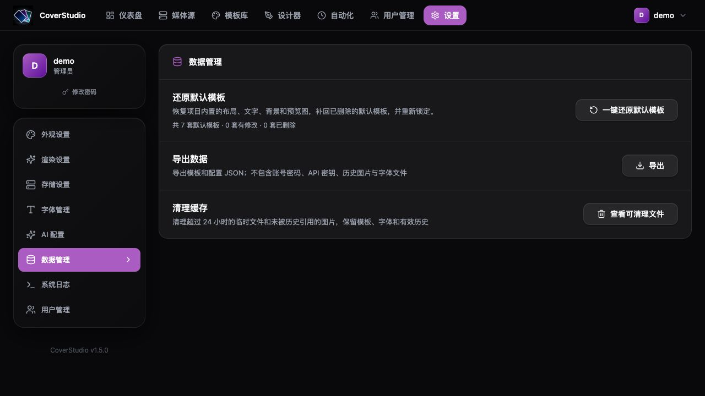
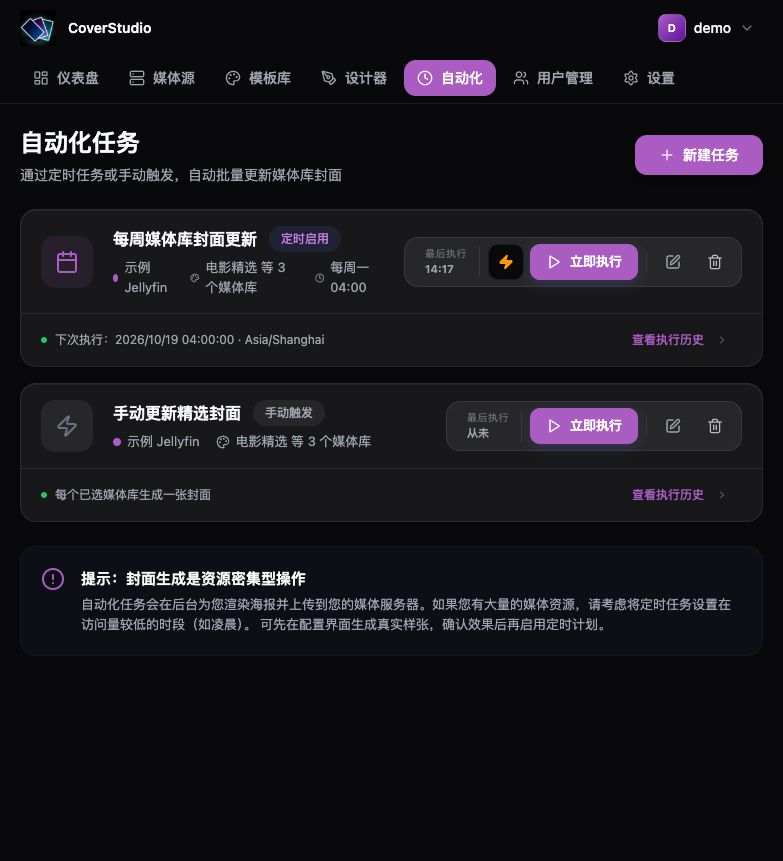
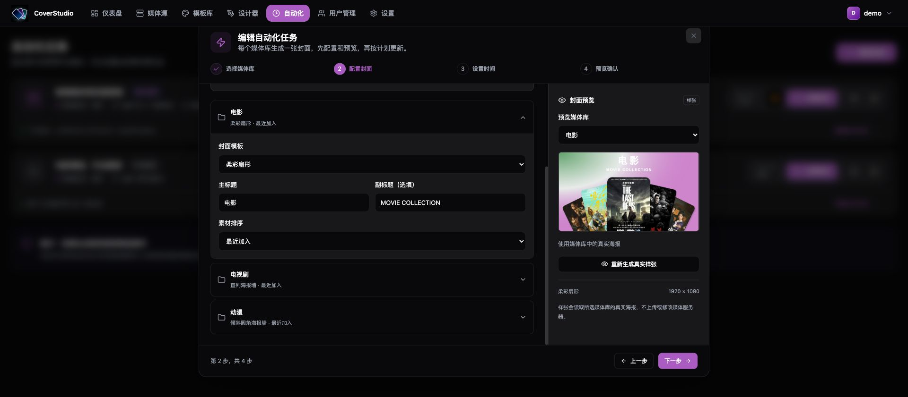
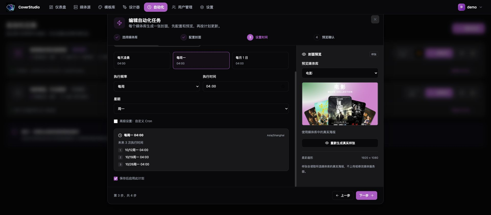
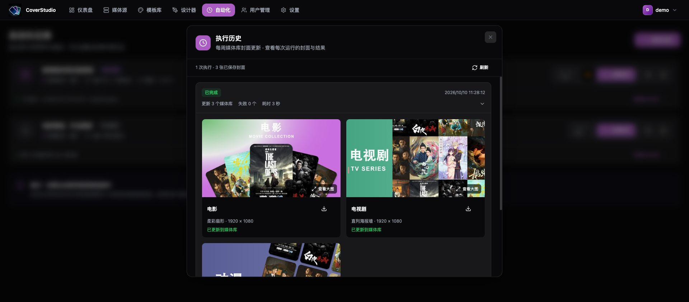

# 🎨 LibraryCoverStudio

**为 Jellyfin / Emby 设计媒体库封面，让电影、剧集和动漫分类按计划自动焕新。**

[](https://github.com/HappyQuQu/library-cover-studio/actions/workflows/ci.yml)
[](https://hub.docker.com/r/evanqu/library-cover-studio)


[Docker 部署](#-docker-部署) · [自动化教程](#-自动化任务教程) · [界面预览](#界面预览) · [完整部署指南](doc/Docker_Deployment.md) · [发布流程](doc/Publishing.md)



## ✨ 能做什么

| 功能 | 使用方式 |
| --- | --- |
| 可视化设计 | 拖拽海报、文字和形状，调整图层、圆角、旋转、描边与背景，实时查看画布。 |
| 七套内置模板 | 首次启动即可使用 1920 × 1080 模板，也可以复制后修改、导入或导出模板。 |
| 社区模板商店 | 从公开 GitHub 模板仓库浏览、搜索和下载设计，下载后自动加入模板菜单，按模板显示全站累计下载次数。 |
| Jellyfin / Emby | 连接媒体服务器，读取媒体库海报，为每个选中的媒体库生成一张分类封面。 |
| 自动更新 | 按天、周、月或自定义 Cron 执行；每个媒体库可单独设置模板、标题和素材排序。 |
| 真实样张 | 保存任务前读取媒体库海报生成样张，预览不会上传或修改媒体服务器。 |
| 执行历史 | 查看每次执行的结果、逐库封面预览，并下载当次生成的原图。 |
| AI 设计助手 | 配置自己的 AI 服务，通过文字或参考图生成可编辑设计；基础功能无需 AI。 |
| 数据维护 | 配置 PNG / JPEG / WebP 输出、历史保留上限、自定义字体、配置导出和缓存清理。 |

## 界面预览

### 社区模板商店

打开「模板商店」浏览社区设计，支持关键词搜索、按下载次数排序和分页。点击「下载并添加」后，模板自动出现在模板库、设计器及自动化的模板菜单中；同一版本不会重复添加，新版本会作为独立模板保存，保留已有编辑。

模板源是 [library-cover-store](https://github.com/HappyQuQu/library-cover-store)。下载次数来自各版本 GitHub Release ZIP 附件，约每小时汇总，目录在应用后端缓存 5 分钟。服务器需要能访问 GitHub 和 raw.githubusercontent.com，无需给应用配置 GitHub Token。

分享模板：从模板库导出 ZIP，解压后将 `template.json` 和 `preview.jpg` 放进模板仓库根目录的独立文件夹，提交 Pull Request。完整格式与上架流程见 [提交指南](https://github.com/HappyQuQu/library-cover-store#提交模板)。仓库首次运行发布工作流后会生成商店目录。



> 商店截图使用隔离演示环境，模板与下载次数为测试数据。

### 模板库：选择风格，复制后开始设计

内置七套模板：柔彩扇形、直列海报墙、倾斜圆角海报墙、斜切大图、柔雾居中标题、圆角叠卡和横幅背景海报列。默认模板已锁定，可直接用于任务；修改时建议先复制，保留原始样式。模板保存历史最多保留最近 50 条，支持回退。管理员可在「设置 → 数据管理」一键还原全部默认模板，补回已删除的模板，并保留还原前的历史。

设计器的「背景设置 → 影片背景」可选择首张海报或首个影片的横向背景图铺满背景，并调节模糊程度与压暗程度。自动化生成时读取对应影片的真实图片，横向背景图缺失时回退首张海报。倾斜圆角海报墙默认使用首张海报模糊背景；横幅背景海报列使用首个影片的横向背景图，底部排列五张直立圆角海报。





### 默认模板恢复：改乱后找回内置样式

管理员进入「设置 → 数据管理」，可一键还原七套默认模板。自建和复制模板会保留，还原前的已保存设计可从模板历史找回。



### 媒体源：连接服务器，查看媒体库

支持 Jellyfin / Emby 基础地址及反向代理子路径，图片通过应用的认证代理读取。


### 自动化：查看计划和执行结果



> 文档截图来自实际运行的应用，使用隔离的演示账号、示例媒体库和项目内置海报；不包含真实服务器配置或密钥。

## 🐳 Docker 部署

只需 Docker 和 Compose v2。新建一个空目录，将下面内容保存为 **`compose.yaml`**（也可下载 [部署示例](doc/compose.yaml)）：

```yaml
services:
  library-cover-studio:
    image: evanqu/library-cover-studio:latest
    restart: unless-stopped
    environment:
      JWT_SECRET: "REPLACE_WITH_RANDOM_JWT_SECRET"
      ENCRYPTION_KEY: "REPLACE_WITH_RANDOM_ENCRYPTION_KEY"
    ports:
      - "8080:8080"
    volumes:
      - ./data:/app/data
```

把 `JWT_SECRET` 和 `ENCRYPTION_KEY` 分别换成不同的随机密钥。可执行两次 `openssl rand -hex 32`，将结果填入对应位置。**升级时保留这两个值。**

在这个目录执行：

```bash
docker compose up -d
```

打开 **[http://192.168.1.10:8080](http://192.168.1.10:8080)**（换成自己的服务器地址；本机使用 `http://localhost:8080`），点击「立即注册」，第一个账号成为管理员。

**一个镜像、一个容器、一个端口。** 网页、API、封面渲染和定时任务均在这个容器中运行，数据自动保存在同目录的 **`data` 文件夹**。改端口只需修改 `8080:8080` 的左侧；NAS 直接使用局域网地址访问，不必另配 `FRONTEND_URL`。镜像标签以 Docker Hub 实际发布结果为准。

NAS 与本机使用同一份配置。首次部署、反向代理、升级备份及源码构建见 **[完整部署教程](doc/Docker_Deployment.md)**。已有安装请先按教程的迁移说明保留原密钥和数据。

## ⚡ 自动化任务教程

一次配置，即可定期更新所选媒体库的封面。以下示例每周一 04:00 更新电影、电视剧和动漫三个分类。

### 1. 连接媒体服务器

在「媒体源 → 添加服务器」填写名称、类型、**后端容器可以访问的服务器地址**和 API 密钥。保存后测试连接并查看媒体库。Docker 容器中的 `localhost` 指向容器自身；媒体服务器在 NAS 或局域网时，应填写它的局域网地址或可访问的域名。

### 2. 选择范围、配置封面

进入「自动化 → 新建任务」，填写任务名称并勾选媒体库。下一步批量应用模板，再按媒体库调整主标题、副标题和素材排序，点击「生成真实样张」检查效果。



### 3. 设置执行时间

在「设置时间」选择「按计划运行」，使用「每周一」预设，或者设置频率和时间。查看调度时区与未来三次执行时间，勾选「保存后启用此计划」。



| 想要的计划 | Cron 表达式 |
| --- | --- |
| 每天 04:00 | `0 4 * * *` |
| 每周一 04:00 | `0 4 * * 1` |
| 每月 1 日 04:00 | `0 4 1 * *` |
| 每小时整点 | `0 * * * *` |

默认调度时区是 `Asia/Shanghai`，以任务页面显示的时区为准。任务执行需要后端持续运行；暂停后停止未来触发，重启后会重新加载已启用的计划。关机期间错过的时间不会自动补跑。

### 4. 确认、执行、查看历史

检查「预览确认」页后保存任务。保存本身不会立即上传；可以先点一次「立即执行」，再在「执行历史」查看结果、封面大图和下载按钮。



**执行会替换所选媒体库的封面。** 应先生成样张，必要时自行备份媒体服务器原封面；执行历史保存的是本项目生成的图片。默认每个任务保留最多 50 次、30 天内的已结束执行，管理员可修改上限。

完整四步教程、变量说明、手动运行、暂停、历史保留与问题排查见 **[自动化使用指南](doc/Automation_Guide.md)**。

## 🤖 AI 与自定义设计

在「设置 → AI 配置」添加自己的服务，填写地址与密钥，获取模型列表并选择默认模型。支持 OpenAI 兼容接口、Claude、Ollama 等服务；模型支持图片输入时，可添加最多 3 张 JPG / PNG / WebP 参考图。能力未知时需要手动确认，生成后可先预览再应用到画布。

自动化封面主要使用 `{{primaryTitle}}`、`{{secondaryTitle}}` 与 `post1`～`post9` 海报占位。勾选「生成任务时随机背景」可让同一布局每次采用不同配色，关闭后使用固定背景。修改后的模板需保存，任务执行才会读取新版本。

## 🧑‍💻 本地开发

环境：Node.js 22、pnpm 10.28.0。开发时前端默认 `5173`，后端默认 `3000`。

```bash
corepack enable
pnpm install --frozen-lockfile
cp .env.example .env
# 编辑 .env，将 JWT_SECRET 和 ENCRYPTION_KEY 改为随机字符串
pnpm db:migrate
pnpm dev
```

```bash
pnpm test          # 隔离数据库与本地模拟媒体 API 的回归测试
pnpm build         # 构建前后端
```

前端使用 React 19、Vite、Tailwind CSS、Fabric.js、Zustand 和 TanStack Query；后端使用 Node.js、Express、SQLite / Drizzle，渲染使用 `@napi-rs/canvas` 与 Sharp。

## 📚 文档与发布

- [Docker 部署教程](doc/Docker_Deployment.md)：安装、NAS 访问、升级与备份恢复。
- [自动化使用指南](doc/Automation_Guide.md)：连接、配置、定时执行与历史记录。
- [GitHub Actions 与 Docker Hub 发布](doc/Publishing.md)：自动检查、版本发布、镜像标签和 Overview 同步。
- [Docker Hub 专用说明](README.dockerhub.md)：适合镜像页面阅读的部署和使用教程。
- [用户手册](doc/Product_Manual.md) · [技术架构](doc/Technical_Architecture.md)。

## 📄 许可证

MIT License。
