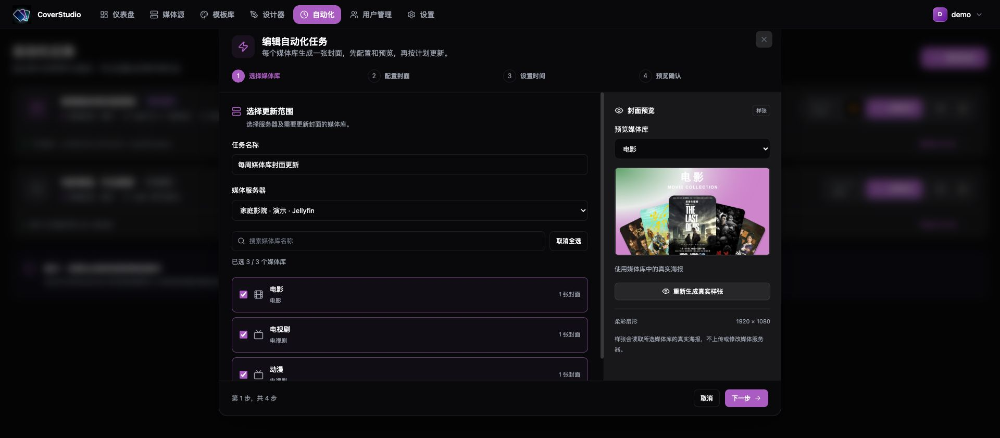
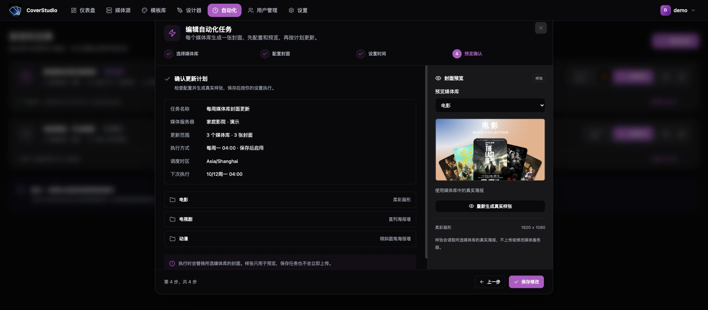

# 自动化任务使用指南

[返回项目首页](../README.md) · [Docker 部署](Docker_Deployment.md)

本教程创建一个「每周媒体库封面更新」任务：每周一 04:00 为电影、电视剧和动漫媒体库分别生成并上传一张封面。截图使用隔离演示数据，操作界面来自实际运行的应用。

## 开始前

1. 在「媒体源」添加 Jellyfin / Emby 服务器，确认连接状态为「在线」且可以读取目标媒体库。
2. 在「模板库」选择内置模板；需要改布局时先复制、编辑并保存。
3. 生成样张确认效果。任务执行会替换媒体库分类封面，需要保留原封面时请提前从媒体服务器备份。

这里更新的是**媒体库分类封面**：选三个媒体库就生成三张封面。媒体库中的电影 / 剧集海报用于封面素材，不会逐部替换影片海报。

## 第一步：选择媒体库

进入「自动化 → 新建任务」，填写名称并选择服务器，勾选要更新的媒体库。媒体库较多时可以搜索或全选当前结果，确认已选数量后点击「下一步」。

也可以选择 Jellyfin / Emby 中的**合集**，列表会标注「合集」以便区分。每个已选合集单独生成一张封面，素材来自该合集成员的海报，上传目标为合集本身；合集成员的电影或剧集海报保持原样。合集与媒体库都支持单独配置模板、主副标题、素材排序、真实样张、手动运行及定时更新。新增或删除合集后，可刷新列表重新选择；空合集可使用无需海报的纯文字模板。

「媒体源」列表会读取并展示合集的现有封面；没有封面时显示默认图标。现有封面用于列表展示，生成样张和执行任务时使用的是合集成员的海报素材。

## 第二步：配置封面

可先通过「统一模板」「素材排序」批量应用设置，再展开某个媒体库单独调整。下面是一组示例配置：

| 媒体库 | 模板 | 主标题 | 副标题 | 素材排序 |
| --- | --- | --- | --- | --- |
| 电影 | 柔彩扇形 | 电影 | MOVIE COLLECTION | 最近加入 |
| 电视剧 | 直列海报墙 | 电视剧 | TV SERIES | 最近加入 |
| 动漫 | 倾斜圆角海报墙 | 动漫 | ANIME COLLECTION | 最近加入 |

| 字段 | 作用 |
| --- | --- |
| 封面模板 | 决定封面布局、文字样式、海报位置和背景。 |
| 主标题 | 替换模板的 `{{primary_title}}`，例如「动漫」。 |
| 副标题 | 替换 `{{secondary_title}}`，可以留空或填写说明。 |
| 素材排序 | 控制从媒体库挑选素材的顺序，如最近加入、随机选取、公众评分。 |
| 预览媒体库 | 切换右侧样张对应的分类。 |

点击右侧「生成真实样张」：读取所选媒体库海报并通过后端真实渲染，**不会上传或更改媒体服务器**。仅显示模板缩略图时，它还是内置示例；生成后界面会显示「使用媒体库中的真实海报」。修改配置后重新生成样张，再继续下一步。

### 自定义模板的变量

在设计器中使用动态变量，而不是把标题写成固定文字：

- `{{primary_title}}`：当前媒体库配置的主标题。
- `{{secondary_title}}`：当前媒体库配置的副标题。
- `post1`～`post9`：海报占位，由任务读取的媒体库素材替换；在设计器使用左侧海报元素及其变量设置。

模板的「生成任务时随机背景」控制是否每次按风格重新配色，关闭后使用固定背景。**先保存模板再运行任务**，任务读取的是数据库中已保存的版本。锁定模板可直接用于任务；复制后得到可编辑副本。

## 第三步：设置时间

### 按计划运行

选择「按计划运行」，使用时间预设或设置频率、执行时间、星期 / 日期。滚动到下方，核对未来三次执行时间并勾选「保存后启用此计划」。

默认调度时区为 `Asia/Shanghai`，以任务配置界面和任务列表显示的时区为准。例如每周一 04:00，是这个调度时区中的凌晨四点，可能与浏览器所在时区不同。

### 手动运行

选择「手动运行」则不注册定时计划。保存后可在任务列表点击「立即执行」，适合第一次验收、临时换风格或不需要周期更新的媒体库。

### 高级 Cron

勾选「高级设置：自定义 Cron」，支持五字段和六字段表达式。常用五字段顺序为「分 时 日 月 周」：

| 计划 | 表达式 |
| --- | --- |
| 每天 04:00 | `0 4 * * *` |
| 每周一 04:00 | `0 4 * * 1` |
| 每月 1 日 04:00 | `0 4 1 * *` |
| 每小时整点 | `0 * * * *` |
| 每天 03:30 | `30 3 * * *` |

六字段在最前面增加「秒」。日期和星期同时指定时需要同时满足；选择每月 29 / 30 / 31 日时，没有该日期的月份不会执行。提交前以界面返回的未来三次执行时间检查计划。

## 第四步：预览确认并保存

检查任务名称、服务器、媒体库数量、各库模板、执行方式和下次执行时间。新任务点击「创建任务」；编辑已有任务时点击「保存修改」。

**保存不会立即上传。** 已启用的定时任务到达计划时间才执行；可先在列表点一次「立即执行」验收。执行时读取素材、生成每个媒体库的封面、上传到服务器并记录结果。

## 管理任务和执行历史

| 操作 | 结果 |
| --- | --- |
| 立即执行 | 手动触发一次，定时任务的周期计划仍然保留。 |
| 暂停定时执行 | 停止后续定时触发，不撤销已经上传的封面；当前已开始的执行仍会完成。 |
| 恢复定时执行 | 重新注册计划，刷新下次执行时间。 |
| 编辑配置 | 修改范围、模板或计划；保存后生效。 |
| 查看执行历史 | 查看逐库状态、当次封面预览、放大图片和下载原图。 |

历史记录里的封面是**当次生成的独立快照**，后续改模板或再次运行不会改写旧图片。失败时若已经生成图片，仍可以查看或下载，以便判断渲染还是上传环节出了问题。

### 历史保留与存储

默认每个任务最多保留最近 **50 次**、**30 天内**的已结束执行，超出任一限制会在后端启动或执行结束时清理。管理员在「设置 → 数据管理」调整保留数量与天数。

「设置 → 存储设置」中的「保存生成的封面」控制额外导出文件；关闭后，执行历史仍会保存原图和预览图。「导出数据」用于导出配置，不包含账号、密钥和图片，也不能代替 [完整数据备份](Docker_Deployment.md#备份)。

## 模板编辑、字体与分享

在「模板库」复制现有模板后进入设计器。左侧添加海报、文字、图片或形状，右侧调整图层位置、尺寸、透明度、字体与层叠顺序。主副标题绑定 `{{primary_title}}` / `{{secondary_title}}`，海报绑定 `post1` 至 `post9`；保存模板后重新生成真实样张，确认标题和素材填充效果。

在「设置 → 字体管理」上传 `.ttf`、`.otf`、`.woff` 或 `.woff2` 字体，再到设计器选择。中文显示为方框时，选用包含中文字形的字体，例如思源黑体。模板导出会携带所需的自定义字体，导入时自动安装。

在「设置 → 渲染设置」调整输出格式、质量与并发数量，并通过样张检查效果。导出模板得到单套 ZIP，可在另一台设备的「模板库 → 导入模板」使用。社区模板的源文件、预览、贡献格式和打包流程统一维护在 [模板商店仓库](https://github.com/HappyQuQu/library-cover-store)。

## 常见问题

| 现象 | 处理 |
| --- | --- |
| 没有媒体库或无法读取素材 | 在媒体源重新测试连接、刷新列表，检查地址和密钥权限。 |
| 样张与内置缩略图不同 | 样张使用所选媒体库海报和配置标题；随机背景开启时配色也可能不同。 |
| 标题没有变化 | 检查模板文字是否用了 `{{primary_title}}` / `{{secondary_title}}`，并保存模板。 |
| 海报为空或不足 | 检查媒体库是否有带主海报的项目，确认库类型和排序；也可选无需海报的「柔雾居中标题」。 |
| 计划时间不对 | 查看任务显示的时区和未来三次时间，核对频率、星期、日期及 Cron。 |
| 到点没有执行 | 后端必须持续运行，任务必须启用；关机期间错过的时间不会自动补跑。 |
| 无法重复执行或删除任务 | 正在执行的任务不能重复手动触发或删除；等当前执行结束。定时触发遇到同一任务仍在运行时会跳过。 |
| 模板无法删除 | 模板锁定时先解锁；被任务引用时需要先改任务解除引用，包括暂停的任务。 |
| 重启后出现失败记录 | 后端会将被重启中断的执行标记为失败，保留已经生成的封面，不会自动重试上传。检查结果后手动运行。 |
| 渲染成功但上传失败 | 查看历史错误和系统日志，检查媒体 API 的管理权限及网络可达性。 |

基础自动化不依赖 AI。要使用 AI 创建布局，先在「设置 → AI 配置」添加服务，再在设计器的「AI」面板生成、预览、应用并保存模板。
