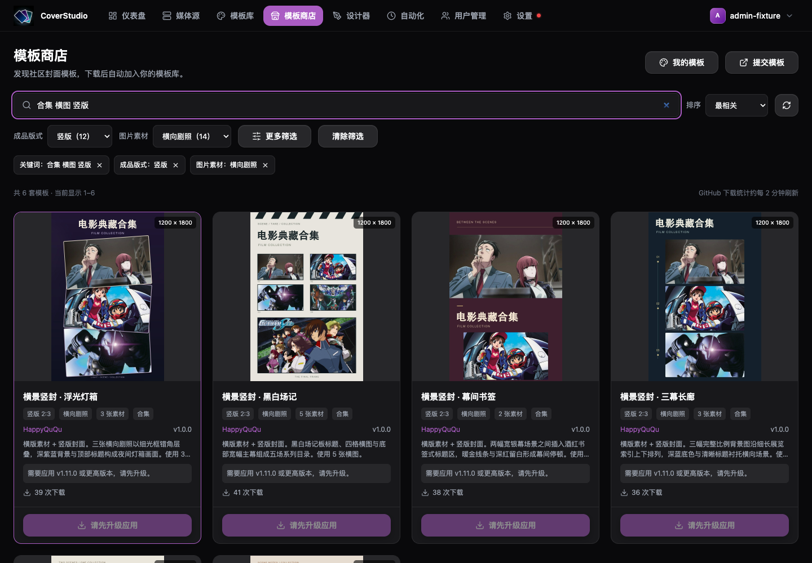
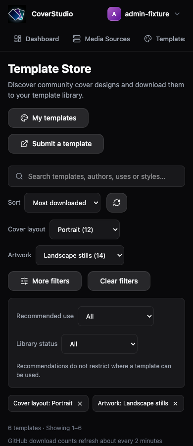
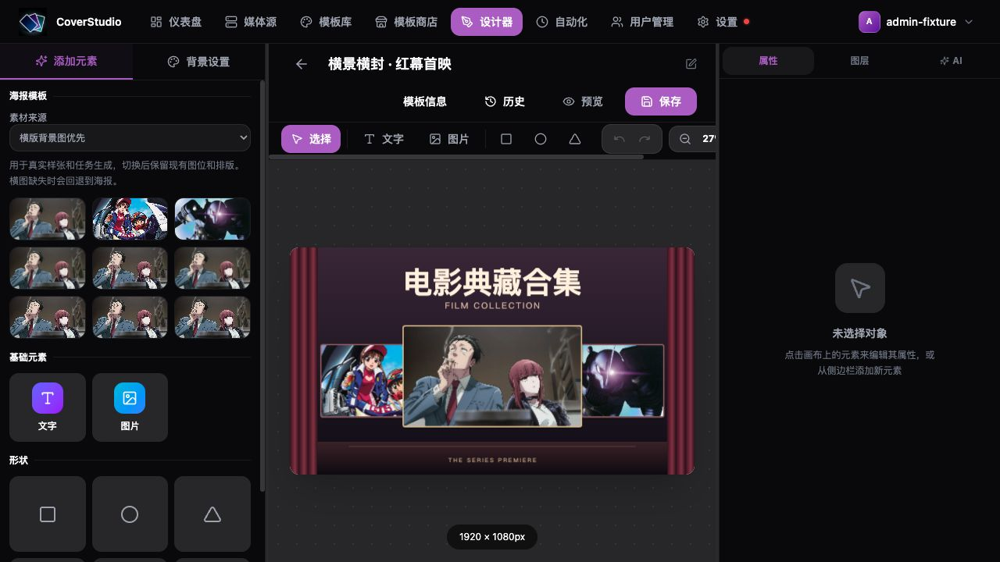
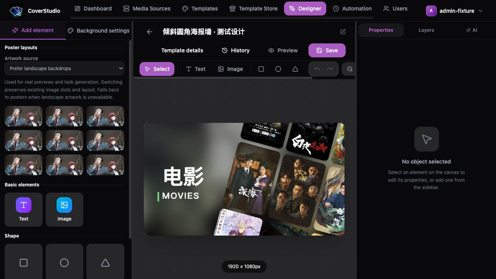

# 中英文界面验收与回归

中文为默认语言与维护基准；英文为显式选择。本文覆盖浏览器回归方法与源内容边界。开发规则见 [贡献指南](../CONTRIBUTING.md)。

## 自动检查

在仓库根目录使用 Node.js 24.22.1 LTS 和 pnpm 10.28.0：

```bash
pnpm check:i18n
pnpm test
pnpm build
```

检查器覆盖整个前端 TS/TSX，校验词典结构、key、插值、单复数、英文残留中文与固定中文。中文注释、字体和技术标识不作为翻译遗漏；源内容精确例外及理由维护在 `scripts/i18n-check.ts`。英文硬编码、文案含义和布局仍需人工核对。

测试逐条渲染两份词典，并验证语言偏好、存储失败、跨标签页同步、日期与时区、错误码、源内容保留、SSE 和后端接口兼容。构建同时检查前后端 TypeScript。

## 可复现的隔离浏览器环境

此环境使用内存数据、项目内置海报与模拟 API，不访问 GitHub、媒体服务器或 AI 服务，不读写真实数据库或设置。只绑定本机回环地址；仅用于本地验证，不用于部署。启动前确认 3199、5175 未被占用；不要停止占用这些端口的其他服务。

安装依赖后，在根目录打开两个终端：

```bash
# 终端 1：可 Ctrl+C 停止，重启即重置内存数据
pnpm dev:i18n-fixture
```

```bash
# 终端 2：显式使用 TypeScript 配置，避免遗留 vite.config.js 覆盖代理
BACKEND_URL=http://127.0.0.1:3199 pnpm --filter ./web exec vite \
  --config vite.config.ts --host 127.0.0.1 --port 5175 --strictPort
```

打开 [隔离界面](http://127.0.0.1:5175)，示例管理员为 `admin-fixture`，密码填 `fixture-only`。`bad-fixture` 用于模拟登录失败；其他用户名用于普通用户界面。这里只输入演示值，不使用真实账号、密码、API Key 或私人图片。模拟注册和设置操作不创建真实账户或配置。

- 所有任务、模板、用户、服务与下载统计均为演示数据。样张和历史图使用内置图片；执行按钮返回模拟启动结果。
- 媒体源名称包含 `fail` 时，添加操作返回鉴权错误。AI 配置测试的 URL 包含 `fail` 时返回鉴权错误。
- AI 文本需求包含 `FAIL`、`LEGACY`、`MALFORMED` 时，分别模拟限流、旧字符串错误和无效 SSE。包含 `STOP` 时持续等待，可验证停止；普通需求在约 12 秒后返回可比较的设计。
- [示例 ZIP](http://127.0.0.1:3199/__i18n/template.zip) 可用于导入界面；文件名为 `i18n-broken.zip` 的任意文件模拟无效包。真实 ZIP 校验、字体安装与渲染由后端测试负责。
- [请求记录](http://127.0.0.1:3199/__i18n/requests) 用于比对字段和请求次数，返回时隐藏凭据与参考图正文；记录只在内存中。切换语言不应增加生成/保存请求。
- 需要干净偏好时使用新浏览器配置文件；也可用 `localhost:5175` 验证独立源的存储隔离。`localhost` 与 `127.0.0.1` 是不同源，不会同步偏好；同一源的标签页应同步。

完成后关闭测试页面与两个终端进程。界面示例截图可保存到 `doc/images/screenshots/`，注明隔离数据；临时证据、请求日志与个人文件放入被忽略的 `temp/`。

## 双语流程清单

每个流程先用中文，再用英文；同时覆盖正常结果、加载/空状态、失败反馈、图标按钮与辅助文本。保留原文的内容不能被判为翻译遗漏。

| 流程 | 操作与核对 |
| --- | --- |
| 默认与偏好 | 无显式偏好时显示中文；登录页切换，刷新、退出再登录仍保留；检查页面 `lang`、通知区域与图标名称。 |
| 普通用户 | 普通用户可改语言；管理员功能继续按权限控制，语言不改变权限。 |
| 媒体源 | 添加/失败、检测连接、展开媒体库、刷新；核对 0/1/多个项目，保留服务器与媒体库名称。 |
| 模板库 | 复制、导入/格式错误、导出、锁定；名称、字体、说明和变量绑定保留原值。 |
| 设计器 | 输入未保存名称，创建文字、绑定变量、选中图层、修改属性；切换后撤销/重做与保存仍可用，样例文字只在创建时填入。海报面板的素材来源默认竖版优先；横图模板自动选中横版优先，切换、撤销/重做及保存重开后状态一致。 |
| 模板信息/历史 | 修改信息但暂不应用时切换；确认原内容保留、历史状态与日期翻译、原版本内容可辨识。 |
| 商店 | 搜索、成品版式、图片素材、推荐用途及添加状态筛选、单项取消与清除筛选、组合关键词、排序、分页、URL 状态恢复、下载、更新/备份确认；标题、作者与社区说明保留原文。 |
| 四步向导 | 选择媒体库、展开配置并修改主副标题、生成样张、设置计划、预览确认、保存；每步切换语言，检查输入、选择、展开项及样张未丢失。 |
| 计划与任务 | 日/周/月/小时/自定义 Cron；时间与星期描述和未来执行时间一致，Cron、调度时区与启用状态不受语言影响。 |
| 执行历史 | 手动启动、展开历史、查看部分失败、放大图、下载原图；状态、计数和耗时翻译，历史错误原文可展开。 |
| 设置 | 在渲染、保留、网络、AI 服务、系统提示词和用户表单保留未保存输入后切换；校验失败仍保留草稿；切换入口不触发字段自动保存。 |
| AI 助手 | 选择模型、添加参考图、输入、生成、比较、继续调整、应用与停止；流中切换不重发请求，需求/系统指令/分析/结果保留原文。 |
| SSE 与兼容 | 验证已知 code、旧字符串和未知反馈；主提示本地化，原诊断可查看；日志断开/重连保留筛选与原条目。 |
| 发布与关于 | 控件翻译、日期正常；社区信息和发布正文按源语言展示并可辨识。 |

## 英文布局检查

布局验收清单以 390、1024、1440 像素宽度覆盖登录、导航、仪表盘、媒体源、模板库、商店、任务、全部设置页、四步向导及设计器图层/属性/AI 面板。几何检查与实际截图检查的范围分别记录，不能互相替代。

- 页面没有整体横向溢出；标题、说明和按钮能换行，关键操作可见或能滚动到达。
- 导航与设计器工具栏允许局部横向滚动；窄屏通过 Canvas / Assets / Properties & AI 切换工作区。
- 弹窗不能被导航遮挡，关闭、上一步、下一步和保存可达；长表单及样张在内部滚动。
- 用户输入、URL、模型 ID、图层名可使用单行编辑/截断；完整值保留，切换语言不改写。
- 颜色、坐标、字体、透明度、圆角、阴影等属性控件的可访问名称跟随语言。
- 手机计划预设、设置菜单与 AI 服务卡片应能完整显示长英文标签；通用弹窗保留两侧边距。
- 修改后记录实际测试范围、未验证项与数据来源；临时截图和请求日志放入被忽略的 `temp/`，提交验证结果写入 PR。


## 商店分类联调

Store 的分类索引和发布脚本需先更新，商店通过 `classification` 读取 `recommendedUses`、`artworkType`、`artworkCount` 和 `tags`。旧目录缺少分类时仍可浏览、搜索和按版式筛选，不将未知素材误标为“无需图片”。分类更新不改变模板包与 revision。

商店 URL 支持 `q`、`orientation`、`artwork`、`use`、`status`、`sort`、`page`、`pageSize`。关键词按空白分隔并同时匹配，支持全半角与大小写归一化，匹配名称、作者、说明、标签和分类别名；有搜索词且没有显式排序时优先相关度，完整名称优先。输入停顿 250 ms 后搜索，回车立即搜索，中文输入法组词期间不发请求。筛选、搜索、排序变化回到第一页；进入设计器再返回时从 URL 恢复条件。

各筛选选项旁的数量是整个商店目录中的数量；结果区显示组合条件下的数量。目录中没有的版式或素材选项不展示，URL 中已有的选中项仍保留，以便恢复或取消。推荐用途可同时包含媒体库和合集，不能按宽高或名称推断。素材数量是排版提示，不作为下载或执行的门槛。

可用 Store 发布脚本的 `scan_templates` 将条目的基本信息、`classification` 和绝对 `previewPath` 写成临时 JSON，再通过 `I18N_STORE_CATALOG=/absolute/path/to/catalog.json pnpm dev:i18n-fixture` 启动隔离界面，查看真实本地预览。此模式会包含未发布模板，只用于本地视觉验证，不代表线上上架或下载成功；接口测试仍使用独立数据库与模拟下载。

2026-10-19 本地验收：使用 Store 的 68 套本地模板与真实预览（含 12 套待发布模板），中英文均检查 390 / 1024 / 1440 像素宽度，未发现整页横向溢出。已检查组合搜索“合集 横图 竖版”与“竖版＋横向剧照”均返回 6 套、更多筛选、无结果、单项取消、清除全部、每页数量、翻页、筛选回到第一页、刷新与返回恢复 URL 条件。中文输入法组词保护由事件逻辑实现，本轮未用真实输入法逐键验收。模拟界面的下载次数和添加状态为演示值，不代表线上统计或已安装状态。应用 158 项回归、Store 18 项测试、前后端构建和 i18n 检查通过；临时截图保存在被忽略的 `temp/store-filters-final/`。





## 海报素材来源

以下截图使用隔离测试环境与模板包内示例素材。素材来源控制真实样张和任务生成的取图优先级，切换时保留现有图位与排版。




