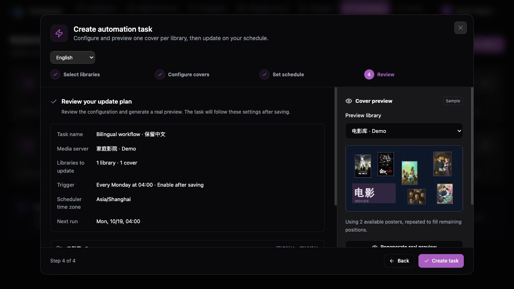
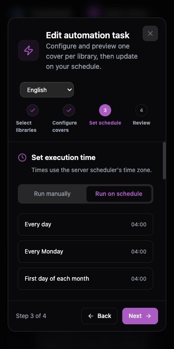

# 中英文界面验收与回归

中文为默认语言与维护基准；英文为显式选择。本文覆盖浏览器回归方法、源内容边界和本轮验证记录。开发规则见 [贡献指南](../CONTRIBUTING.md)，五阶段记录见 [实施方案](I18n_Plan.md)。

## 自动检查

在仓库根目录使用 Node.js 22 和 pnpm 10.28.0：

```bash
pnpm check:i18n
pnpm test
pnpm build
```

检查器覆盖整个前端 TS/TSX，校验词典结构、key、插值、单复数、英文残留中文与固定中文。中文注释、字体和技术标识不作为翻译遗漏；源内容精确例外及理由维护在 `scripts/i18n-check.ts`。英文硬编码、文案含义和布局仍需人工核对。

测试逐条渲染两份词典，并验证语言偏好、存储失败、跨标签页同步、日期与时区、错误码、源内容保留、SSE 和后端接口兼容。构建同时检查前后端 TypeScript。

## 可复现的隔离浏览器环境

此环境使用内存数据、项目内置海报与模拟 API，不访问 GitHub、媒体服务器或 AI 服务，不读写真实数据库或设置。只绑定本机回环地址；仅用于本地验证，不用于部署。启动前确认 3199、5175 未被占用；不要停止占用这些端口的其他服务。

安装依赖后，在根目录打开两个终端：

```bash
# 终端 1：可 Ctrl+C 停止，重启即重置内存数据
pnpm dev:i18n-fixture
```

```bash
# 终端 2：显式使用 TypeScript 配置，避免遗留 vite.config.js 覆盖代理
BACKEND_URL=http://127.0.0.1:3199 pnpm --filter ./web exec vite \
  --config vite.config.ts --host 127.0.0.1 --port 5175 --strictPort
```

打开 [隔离界面](http://127.0.0.1:5175)，示例管理员为 `admin-fixture`，密码填 `fixture-only`。`bad-fixture` 用于模拟登录失败；其他用户名用于普通用户界面。这里只输入演示值，不使用真实账号、密码、API Key 或私人图片。模拟注册和设置操作不创建真实账户或配置。

- 所有任务、模板、用户、服务与下载统计均为演示数据。样张和历史图使用内置图片；执行按钮返回模拟启动结果。
- 媒体源名称包含 `fail` 时，添加操作返回鉴权错误。AI 配置测试的 URL 包含 `fail` 时返回鉴权错误。
- AI 文本需求包含 `FAIL`、`LEGACY`、`MALFORMED` 时，分别模拟限流、旧字符串错误和无效 SSE。包含 `STOP` 时持续等待，可验证停止；普通需求在约 12 秒后返回可比较的设计。
- [示例 ZIP](http://127.0.0.1:3199/__i18n/template.zip) 可用于导入界面；文件名为 `i18n-broken.zip` 的任意文件模拟无效包。真实 ZIP 校验、字体安装与渲染由后端测试负责。
- [请求记录](http://127.0.0.1:3199/__i18n/requests) 用于比对字段和请求次数，返回时隐藏凭据与参考图正文；记录只在内存中。切换语言不应增加生成/保存请求。
- 需要干净偏好时使用新浏览器配置文件；也可用 `localhost:5175` 验证独立源的存储隔离。`localhost` 与 `127.0.0.1` 是不同源，不会同步偏好；同一源的标签页应同步。

完成后关闭测试页面与两个终端进程。界面示例截图可保存到 `doc/images/screenshots/`，注明隔离数据；临时证据、请求日志与个人文件放入被忽略的 `temp/`。

## 双语流程清单

每个流程先用中文，再用英文；同时覆盖正常结果、加载/空状态、失败反馈、图标按钮与辅助文本。保留原文的内容不能被判为翻译遗漏。

| 流程 | 操作与核对 |
| --- | --- |
| 默认与偏好 | 无显式偏好时显示中文；登录页切换，刷新、退出再登录仍保留；检查页面 `lang`、通知区域与图标名称。 |
| 普通用户 | 普通用户可改语言；管理员功能继续按权限控制，语言不改变权限。 |
| 媒体源 | 添加/失败、检测连接、展开媒体库、刷新；核对 0/1/多个项目，保留服务器与媒体库名称。 |
| 模板库 | 复制、导入/格式错误、导出、锁定；名称、字体、说明和变量绑定保留原值。 |
| 设计器 | 输入未保存名称，创建文字、绑定变量、选中图层、修改属性；切换后撤销/重做与保存仍可用，样例文字只在创建时填入。 |
| 模板信息/历史 | 修改信息但暂不应用时切换；确认原内容保留、历史状态与日期翻译、原版本内容可辨识。 |
| 商店 | 搜索、排序、分页、下载、更新/备份确认；标题、作者与社区说明保留原文。 |
| 四步向导 | 选择媒体库、展开配置并修改主副标题、生成样张、设置计划、预览确认、保存；每步切换语言，检查输入、选择、展开项及样张未丢失。 |
| 计划与任务 | 日/周/月/小时/自定义 Cron；时间与星期描述和未来执行时间一致，Cron、调度时区与启用状态不受语言影响。 |
| 执行历史 | 手动启动、展开历史、查看部分失败、放大图、下载原图；状态、计数和耗时翻译，历史错误原文可展开。 |
| 设置 | 在渲染、保留、网络、AI 服务、系统提示词和用户表单保留未保存输入后切换；校验失败仍保留草稿；切换入口不触发字段自动保存。 |
| AI 助手 | 选择模型、添加参考图、输入、生成、比较、继续调整、应用与停止；流中切换不重发请求，需求/系统指令/分析/结果保留原文。 |
| SSE 与兼容 | 验证已知 code、旧字符串和未知反馈；主提示本地化，原诊断可查看；日志断开/重连保留筛选与原条目。 |
| 发布与关于 | 控件翻译、日期正常；社区信息和发布正文按源语言展示并可辨识。 |

## 英文布局检查

布局验收清单以 390、1024、1440 像素宽度覆盖登录、导航、仪表盘、媒体源、模板库、商店、任务、全部设置页、四步向导及设计器图层/属性/AI 面板。几何检查与实际截图检查的范围分别记录，不能互相替代。

- 页面没有整体横向溢出；标题、说明和按钮能换行，关键操作可见或能滚动到达。
- 导航与设计器工具栏允许局部横向滚动；窄屏通过 Canvas / Assets / Properties & AI 切换工作区。
- 弹窗不能被导航遮挡，关闭、上一步、下一步和保存可达；长表单及样张在内部滚动。
- 用户输入、URL、模型 ID、图层名可使用单行编辑/截断；完整值保留，切换语言不改写。
- 颜色、坐标、字体、透明度、圆角、阴影等属性控件的可访问名称跟随语言。

## 2026-10-14 验证记录

| 项目 | 结果与边界 |
| --- | --- |
| 自动验证 | Node 22：1,246 个双语词条通过检查，35 个测试文件共 145 项测试通过，前后端构建通过，`git diff --check` 通过。 |
| 本轮中文流程 | 登录、媒体源检测与项目计数、模板复制、封面主副标题、样张、每周计划、任务保存、启动、历史与原图下载。 |
| 本轮英文流程 | 偏好刷新/退出保留、登录失败与成功、媒体源、商店下载、四步向导、样张、每周计划、保存、启动、历史与原图下载。 |
| 状态保护 | 向导中切换保留样张和任务名；跨标签页切换保留未保存模板名、选中属性、变量绑定与撤销/重做。保存请求中的原文字与绑定不变。 |
| AI 与独立偏好 | 流中切换保留原需求和模型分析，实际只发送 1 次生成请求，未加入界面语言字段；同源标签页同步，另一独立源仍显示默认中文。 |
| 布局 | 先前在 390 / 1024 / 1440 px 完成主要页面、设置分区、四步向导及图层面板的几何检查；提交前追加 360 / 390 / 1024 / 1280 px 实际截图审查，具体范围见下表。1440 px 不计入本次可靠截图证据。 |
| 提交前复审 | 修复弹窗提高层级后遮挡通知、异步通知沿用请求开始时的旧语言，以及字体上传 413 误报模板包大小限制；新增检查防止通知继续使用绑定旧语言的 t。浏览器延迟请求中切换到英文后，错误通知使用英文并显示在弹窗上方，原表单输入保留。 |
| 先前阶段回归 | 导入导出、商店更新/备份、模板历史、设置草稿、参考图、停止/限流/旧错误/异常 SSE 和日志重连已在前几阶段用隔离接口验证；相关自动测试本轮全部重跑。 |
| 真实业务边界 | 浏览器流程使用模拟 API，不代表真实上传、商店统计或外部 AI 服务成功。真实渲染、媒体适配器、包校验、历史、调度与 AI 协议使用后端的临时数据库/本地服务集成测试验证。本轮没有调用真实媒体服务器、GitHub 下载或付费 AI。 |
| 剩余独立优化 | 主 JS 包约 617 kB，构建有超过 500 kB 的非阻断提示；代码拆分不属于语言功能验收。多浏览器配置文件的独立偏好可按上述清单再做发布环境抽查，本轮使用同一浏览器的独立源隔离验证。 |




## 提交前追加英文长文案审查

使用上述隔离环境，逐张查看当前运行生成的截图；没有使用真实账号、媒体服务或 AI 服务。桌面实际截图宽度为 1280 px，另以 1024 px 检查主要紧凑布局，手机检查 390 px 并将高风险区域缩到 360 px。原始证据保存在本地忽略目录 `temp/i18n-en-layout-audit/`，不作为安装包或自动化测试的一部分。

| 步骤 | 实际截图范围与结果 | 本地证据编号 |
| --- | --- | --- |
| 1 登录、导航与仪表盘 | 360 / 1280 px：通过。长说明自然换行；导航局部横向滚动，账户和登录按钮可达。 | 26、27、35、36、37 |
| 2 媒体源与连接弹窗 | 1280 px 页面、360 px 弹窗：通过。字段和连接按钮清晰，原始服务器名保留。 | 01、31 |
| 3 模板库、商店与通用弹窗 | 390 / 1280 px 页面、360 px 导入与 390 px 更新弹窗：通过。通用弹窗补 16 px 两侧边距，长说明可滚动，底部按钮自然换行。 | 09、11、12、33、38、39、44 |
| 4 任务、四步向导、计划与历史 | 390 px 四步及历史、360 px 计划、1024 px 任务和向导：通过。手机计划预设改为逐行排列，月度选项完整显示；任务提示拆为两段，避免英文句子粘连。向导底部按钮保持可见。 | 03–08、32、42、43 |
| 5 设置与 AI 配置 | 360 / 390 / 1024 / 1280 px：通过。修复菜单居中拆行及图标收缩；手机服务卡片的操作按钮另起一行，模型名称不再被挤窄。存储、网络和 AI 表单长标签自然换行。 | 13–20、28–30、40、41 |
| 6 设计器与 AI 助手 | 390 / 1024 / 1280 px：通过。紧凑窗口按工作区切换，工具栏和对话内容局部滚动，输入框、语言选择和生成操作无重叠。 | 21–25 |

本次修复只涉及排列、对齐、边距及提示段落，不改表单值、请求参数、画布或 AI 对话。正常说明段落和双行标签仍允许换行，没有通过缩小全局字号消除换行。上述为当前内置界面文案与示例数据的抽查，不声称涵盖任意用户长文本、全部屏幕高度、浏览器或完整无障碍认证。


