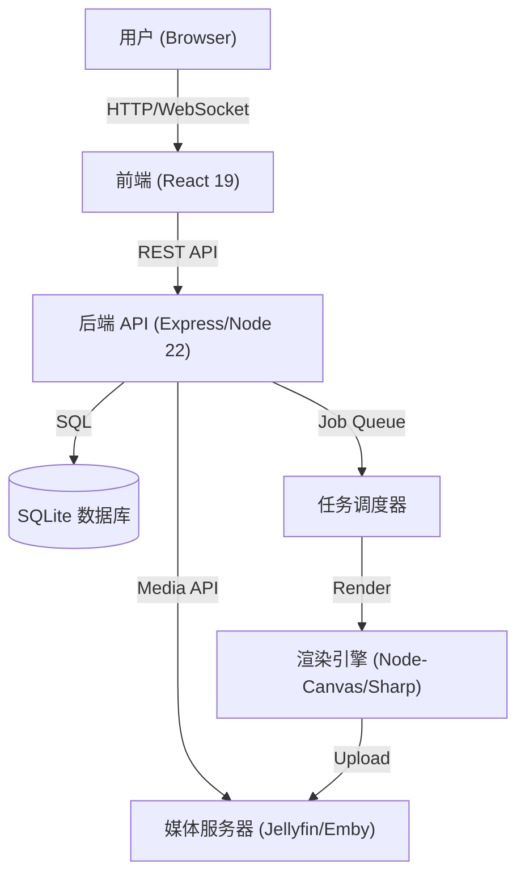
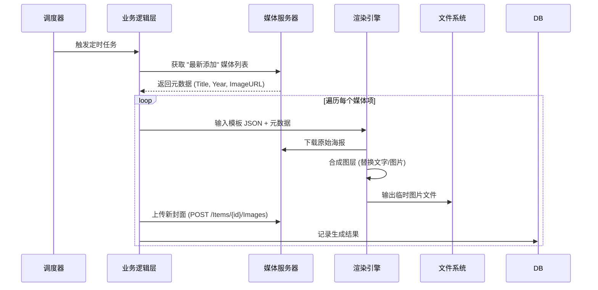

# 🛠️ LibraryCoverStudio 技术架构文档

> **版本**: 1.3.0
> **更新日期**: 2026-01-18

## 1. 系统架构概览

本系统采用现代化的前后端分离架构，旨在提供高性能、高交互性的媒体封面设计体验。

### 1.1 系统上下文 (System Context)



### 1.2 核心流程：海报生成数据流



---

## 2. 工程结构设计 (Standard Monorepo)

项目采用平级根目录结构，最大化工具链兼容性与开发清晰度。

### 2.1 目录树布局

```bash
library-cover-studio/
├── backend/                # 后端应用 (Node.js 22 + Express)
│   ├── config/            # 环境变量与应用配置
│   ├── database/          # SQLite 数据层 (Migrations/Seeds)
│   ├── src/
│   │   ├── controllers/   # HTTP 控制器 (REST API 接口)
│   │   ├── middleware/    # 中间件 (Auth, Logger, Zod Validation)
│   │   ├── routes/        # 路由定义
│   │   ├── services/      # 业务逻辑 (Scheduler, ImageProcessor)
│   │   └── utils/         # 通用工具
│   ├── uploads/           # 运行时临时文件存储
│   └── package.json
├── web/                    # 前端应用 (React 19 + Vite)
│   ├── src/
│   │   ├── api/           # API 客户端 (Axios/TanStack Query)
│   │   ├── components/    # 组件库
│   │   │   ├── ui/        # shadcn/ui 基础组件 (Button, Dialog, etc.)
│   │   │   └── editor/    # 核心业务组件 (Canvas, LayerPanel)
│   │   ├── pages/         # 页面视图 (Layouts, Routes)
│   │   ├── stores/        # 状态管理 (Zustand)
│   │   ├── hooks/         # 自定义 Hooks (useCanvas, useAuth)
│   │   └── lib/           # 工具函数与常量
│   └── package.json
└── docker-compose.yml      # 容器编排配置
```

---

## 3. 详细技术实现

### 3.1 前端：下一代交互体验

核心目标是打造 **"Premium & Fluid"** 的视觉与操作体验。

- **核心框架**: **React 19**。充分利用 `React Compiler` 实现零手动 memo，以及 `Actions` 简化表单与数据变更流程。
- **UI 系统**: **TailwindCSS v4** + **shadcn/ui**。
  - _Tailwind v4_: 利用新的 Rust 引擎实现毫秒级即时编译，无运行时开销。
  - _shadcn/ui_: 基于 Radix UI 的无头组件，提供极高的可访问性 (A11y) 和完全的可定制权。
- **Canvas 引擎**: **Fabric.js (v6)**。
  - 通过 `useCanvas` Hook 封装 Fabric 实例的生命周期。
  - 实现“画布即数据”：前端 Canvas 的 JSON 数据直接用于后端渲染，保证 100% 还原度。

### 3.2 后端：高性能无头渲染

后端不仅提供 API，更是自动化的核心引擎。

- **运行时**: **Node.js 22 LTS**。利用最新的 V8 性能优化和原生 Fetch API。
- **渲染方案**: **Headless Rendering**。
  - 使用 `automattic/node-canvas` 在服务端模拟浏览器 Canvas 环境。
  - 加载 Fabric.js 的 Node 版本，直接解析前端设计的模板 JSON。
  - _优化策略_: 对无需复杂滤镜的简单合成任务，智能降级使用 `Sharp` 库以提升 5-10x 的处理速度。

### 3.3 安全与数据

- **敏感数据**: Jellyfin/Emby 的 API Key 均经过 AES-256 加密落库。
- **鉴权**: 采用标准 JWT (JSON Web Token) 机制，配合 Refresh Token 策略。

---

## 4. 部署与运维

### 4.1 容器化 (Docker)

- **Backend**: `node:22-alpine`。镜像轻量化，预装中文字体 (`wqy-zenhei`) 解决乱码问题。
- **Frontend**: 多阶段构建。Build 阶段生成静态文件，Run 阶段使用 `nginx:alpine` 纯静态托管，开启 Gzip/Brotli 压缩。

### 4.2 扩展性规划

- **并发控制**: 使用 `p-limit` 限制图片生成并发数，防止低配 NAS 内存溢出。
- **队列架构**: 设计预留了 Redis 接口，未来可将渲染任务剥离为独立的 Worker 微服务，实现集群化部署。
